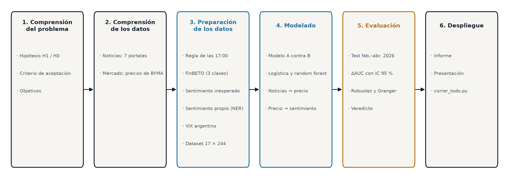
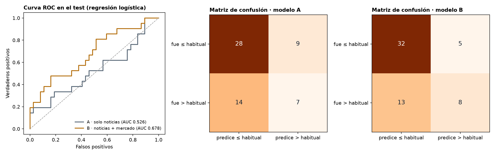

  

# Impacto de shocks informativos en el comportamiento bursátil de empresas argentinas

### Un enfoque basado en análisis de sentimiento y modelos de series temporales

**Trabajo Final de Grado · Licenciatura en Ciencia de Datos** 
Universidad del Gran Rosario · Seminario de Trabajo Final

[**Leer la tesina (PDF)**](6_despliegue/informe/Informe_Final_NicolasDiddi-GinoFrigoni.pdf)

[**Ver la presentación (PPTX)**](6_despliegue/presentacion/Presentacion_Tesina.pptx) · [PDF](6_despliegue/presentacion/Presentacion_Tesina.pdf) · [**Guion**](6_despliegue/presentacion/GUION_PRESENTACION.md)

Versión 6.0. La versión anterior (5.0) está en la rama <a href="https://github.com/ginofrigoni/frigoni-diddi-shock-bursatil/tree/version-5"><code>version-5</code></a>.

---

## Autores

| | |
|---|---|
| **Gino Frigoni** | Lado de noticias: corpus, análisis de sentimiento (FinBETO) y reconocimiento de entidades |
| **Nicolás Diego Diddi** | Lado bursátil: panel de acciones, VIX argentino y regímenes de mercado |

El modelado y la evaluación, que responden la pregunta de la tesina, son trabajo de ambos.

## Docentes

- **Alejandro Mario Hernandez**
- **Briant Alcides Gauna**
- **Jorge Manuel Fernández Acuña**

---

## De qué se trata

En la bolsa argentina está muy extendida la idea de que *«las noticias mueven las acciones»*. Los días de noticias grandes, como los posteriores a una elección, son también días de movimientos fuertes del S&P Merval. Pero esa coincidencia no dice qué vino primero: puede que las noticias muevan al mercado, o que los medios cuenten lo que el mercado ya hizo.

Esta tesina construye y evalúa una **metodología de ciencia de datos** que **mide el sentimiento** de las noticias económicas argentinas y lo **relaciona** con las acciones de BYMA, durante un año de ruedas (mayo de 2025 a abril de 2026). La relación se pone a prueba con un **modelo predictivo**, evaluado en ruedas que nunca vio, en las dos direcciones.

### Cuatro resultados

| | Resultado | Qué es |
|:---:|---|---|
| 📰 | **Corpus de noticias** | 14.012 notas de Clarín, La Nación, Infobae, Ámbito, TN, El Economista e iProfesional, recolectadas con la Wayback Machine y los mapas del sitio, auditadas y asignadas a la rueda en que el mercado pudo reaccionar |
| 🌡️ | **FinBETO** | BETO adaptado a la prensa económica que clasifica cada oración como positiva, negativa o neutra: F1 macro de 0,697 en noticias no vistas, contra 0,542 de un modelo existente |
| 📈 | **Variables por acción y rueda** | Sentimiento inesperado, sentimiento propio de 17 empresas (con reconocimiento de entidades), retorno, volumen anormal y un VIX argentino con su escala |
| 🧪 | **Modelo predictivo** | Regresión logística y random forest: un modelo sin la información del otro lado contra uno con ella, comparados por ΔAUC en los últimos tres meses |

 El pipeline de la tesina, organizado según las seis fases de CRISP-DM.

### Qué encontramos

> **Los medios económicos argentinos, en el período estudiado, siguieron al mercado.**

| Criterio de aceptación de la hipótesis | Resultado | ¿Cumple? |
|---|---|:---:|
| FinBETO supera a un modelo de sentimiento existente | F1 macro 0,697 contra 0,542 | ✅ |
| Las noticias ayudan a predecir el precio | ΔAUC −0,012 [−0,054; +0,036] | ❌ |
| El mercado ayuda a predecir el sentimiento | ΔAUC **+0,152** [+0,074; +0,267] | ✅ |

- **Las noticias no anticipan al mercado.** Agregar el sentimiento no mejora la predicción de si una acción sube al día siguiente, en ninguna de las nueve variantes de robustez.
- **El mercado anticipa a las noticias.** Agregar el retorno del Merval mejora la predicción del sentimiento de la rueda siguiente. Lo que más pesa es el cierre del mismo día. Granger da lo mismo: retorno → sentimiento en 14 de 17 empresas y sentimiento → retorno en 0 de 17.
- **Se rechaza la hipótesis nula:** la metodología mide el sentimiento y lo relaciona con el mercado, en una sola dirección.

 Precio → sentimiento en el test: el modelo con el mercado (B) se separa del azar; el modelo sin él (A), no.

---

## Organización del repositorio

Cada fase de CRISP-DM es una carpeta, y adentro hay una subcarpeta por tema. Cada subcarpeta tiene su `README.md` (qué hace, qué recibe y qué entrega), su script, una carpeta `salidas/` con los resultados y un `metricas.csv` con los números que usan el informe y la presentación.

| Carpeta | Contenido |
|---|---|
| 📂 [`1_comprension_del_problema/`](1_comprension_del_problema/) | Hipótesis, criterio de aceptación y objetivos |
| 📂 [`2_comprension_de_los_datos/`](2_comprension_de_los_datos/) | El corpus de noticias y los precios de BYMA |
| 📂 [`3_preparacion_de_los_datos/`](3_preparacion_de_los_datos/) | Regla de las 17:00 · FinBETO · sentimiento por rueda y por empresa · VIX argentino · dataset unificado |
| 📂 [`4_modelado/`](4_modelado/) | Modelo A contra B: noticias → precio y precio → sentimiento |
| 📂 [`5_evaluacion/`](5_evaluacion/) | Veredicto sobre la hipótesis · robustez · VAR y Granger |
| 📂 [`6_despliegue/`](6_despliegue/) | La tesina en LaTeX (con los papers citados) y la presentación (PPTX, PDF y guion) |

Ningún número de la tesina se escribe a mano: `6_despliegue/informe/numeros.py` los toma de los resultados al compilar. En el PDF, debajo de cada referencia está la ruta del paper dentro de este repositorio; con un lector de escritorio, la ruta abre el archivo.

## Cómo se reproduce

| Parte | Cómo |
|---|---|
| **Todo el pipeline** | `python correr_todo.py`. Corre todos los pasos en orden (unos 2 minutos), verifica los **56 controles automáticos** y compara los **82 archivos de resultados** con la corrida anterior. Opciones: `--con-robustez` (unos 25 minutos), `--con-informe` (compila el PDF) y `--con-gpu` (reentrena FinBETO) |
| **Entorno** | Python 3.14 con `requirements.txt`. Para `--con-gpu`, un entorno con torch y CUDA (ver `requirements.txt`) |
| **Tesina** | Desde `6_despliegue/informe`, `python compilar_tesina.py` genera el PDF, con [tectonic](https://tectonic-typesetting.github.io/) en `~/tools/tectonic/tectonic.exe` |
| **Corpus** | Los scrapers están en `2_comprension_de_los_datos/noticias/scripts_recoleccion` como documentación. La recolección usa credenciales de Internet Archive en un `.env`, que no se sube: copiar `.env.example` y completarlo |

### Archivos excluidos

GitHub no acepta archivos de más de 100 MB. Estos quedaron afuera por su tamaño:

| Archivo | Cómo se obtiene |
|---|---|
| `3_preparacion_de_los_datos/sentimiento_finbeto/modelos/beto_further_pretrained/model.safetensors` | Pesos de BETO con preentrenamiento continuado sobre el corpus; copia de los autores |
| `…/modelos/baseline_finiteautomata/pytorch_model.bin` | Modelo de referencia, de Hugging Face: [`finiteautomata/beto-sentiment-analysis`](https://huggingface.co/finiteautomata/beto-sentiment-analysis), revisión `9384c7f3…` |
| `…/modelos/beto_finetuned_3clases/` | FinBETO de 3 clases: se genera con `fase3_reentrenar_para_medir.py` |
| `…/datos/oraciones_corpus.csv` y `…/salidas/beto_oraciones_finetuned.csv` | Las 413.515 oraciones del corpus y su clasificación: se genera con `clasificar_oraciones.py` |
| `3_preparacion_de_los_datos/sentimiento_por_empresa/datos/ner_oraciones.csv` | Salida del reconocimiento de entidades (`ner_analisis.ipynb`) |

Tampoco se suben los entornos (`.venv/`) ni el archivo de credenciales `.env`.

---

Gino Frigoni · Nicolás Diego Diddi — Universidad del Gran Rosario, 2026

